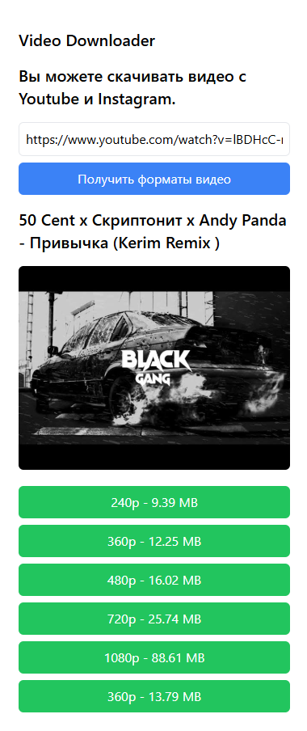

# [Скачивальщик видео](https://downloader.pozhar.keenetic.pro/)
Инструкция по запуску на сервере находится в [PRODUCTION.md](PRODUCTION.md).
#### [Ссылка на приложение](https://downloader.pozhar.keenetic.pro/) ⬅️
## Поддерживаемые сервисы
- Youtube
- Instagram
- VK

Вставьте ссылку на видео и выберите формат для скачивания.



## Локальный запуск из PowerShell 7 на Windows

Выполняйте команды из корня проекта. Нужны Python 3.12, FFmpeg (в PATH или `ffmpeg\ffmpeg.exe` в проекте), доступ к сайтам и их медиасерверам. Нужны доступные с Windows Redis с выделенной логической БД для очереди ARQ и S3 с отдельным бакетом для превью. Используйте сервисы с данными проекта в каталоге проекта. Для превью нужен доступ на запись приложению и чтение браузеру.

```powershell
pwsh -NoProfile -File .\scripts\local.ps1 prepare
if (!(Test-Path .local\services.env)) { Copy-Item scripts\services.env.example .local\services.env }
```

Укажите в `.local\services.env` адреса и учётные данные выделенных сервисов. Замените все `REPLACE_ME` в настройках S3. При нестандартном расположении Python добавьте к `prepare` параметр `-BasePython 'C:\путь\python.exe'`. Для автономной установки поместите полный комплект wheel-файлов для вашей версии Windows и Python в `.local\wheels\`. При наличии этой папки установка использует только её.

Запустите каждую команду в отдельном окне PowerShell. По адресу `http://127.0.0.1:8000/` откроется сайт. Для остановки нажмите **Ctrl+C** в окне нужного компонента. Для перезапуска повторите его команду.

```powershell
pwsh -NoProfile -File .\scripts\local.ps1 worker
pwsh -NoProfile -File .\scripts\local.ps1 web
```

В третьем окне выполните проверки. Они открывают страницу сервиса, запрашивают форматы, запускают задачу, дожидаются статуса `completed` и получают файл через `/api/get-video/{task_id}`. FFmpeg декодирует первый видеопоток до конца. При успехе команда выводит путь в `.local\verified\` и число декодированных кадров. Рабочие загрузки сервера находятся в `.local\downloads\`, временные файлы и кеш pip — в `.local\`.

```powershell
pwsh -NoProfile -File .\scripts\local.ps1 check -Site youtube
pwsh -NoProfile -File .\scripts\local.ps1 check -Site instagram
```

## Локальный запуск без Docker

На Windows весь стек можно запустить в Ubuntu 24.04 под WSL. Если Ubuntu 24.04 ещё не установлена, выполните в PowerShell `wsl --install -d Ubuntu-24.04` и завершите настройку пользователя в Ubuntu.

В PowerShell из корня проекта установите зависимости Ubuntu один раз.

```powershell
wsl -d Ubuntu-24.04 -- sudo apt-get update
wsl -d Ubuntu-24.04 -- sudo apt-get install -y python3-venv ffmpeg redis-server curl
```

Затем запустите стек командой:

```powershell
wsl -d Ubuntu-24.04 -- bash scripts/run-local.sh
```

При первом запуске скрипт установит Python-зависимости в виртуальное окружение и скачает SeaweedFS. Он запустит локальные Redis, S3, воркер ARQ и веб-приложение. Конфигурация и данные находятся в `~/.local/share/downloader-video` внутри Ubuntu, если не задан `XDG_DATA_HOME`.

- [Сайт](http://127.0.0.1:8000/)

Логи приложения и воркера выводятся в терминал, логи Redis и S3 сохраняются в подкаталоге `logs`. Нажмите `Ctrl+C` для остановки стека.

## Локальный тестовый инстанс в Docker

Запустите Docker Desktop в режиме Linux-контейнеров. Из корня проекта выполните в PowerShell.

```powershell
Copy-Item .env.test.example .env.test
docker compose --env-file .env.test -f docker-compose.test.yaml up --build --wait
```

Первую команду достаточно выполнить один раз. Если порт `8085` или `8333` занят, измените `TEST_WEB_PORT` или `TEST_S3_PORT` в `.env.test` перед запуском.

- [Сайт](http://127.0.0.1:8085/)
- [Документация API](http://127.0.0.1:8085/docs)

Compose запускает веб-сервис, воркер ARQ, Redis и S3-хранилище SeaweedFS. Redis доступен внутри сети Compose. Сайт и S3 доступны на `127.0.0.1`. Контейнер `s3-init` настраивает чтение объектов по ссылке и завершается с кодом `0`.

Проверить состояние и посмотреть логи можно следующими командами.

```powershell
docker compose --env-file .env.test -f docker-compose.test.yaml ps -a
docker compose --env-file .env.test -f docker-compose.test.yaml logs --tail=100 downloader_video worker s3-init
```

Остановить стенд с сохранением данных в тестовых томах можно командой `down`.

```powershell
docker compose --env-file .env.test -f docker-compose.test.yaml down
```

## 🛠 Стэк технологий
- python 3.12
- - fastapi
- - asyncio
- - aiohttp
- - aiofiles
- - beautifulsoup4
- - uvicorn
- - jinja2
- - pydantic
- - pytubefix
- docker
- - docker-compose
- minio

## Дополнение 📌
Пользоваться приложением можно абсолютно бесплатно.  
Учитывайте, что оно работает на чистом энтузиазме и иногда может сбоить.  
Также вы можете поддержать автора.  
Реквизиты: 4276 4200 2835 2325
